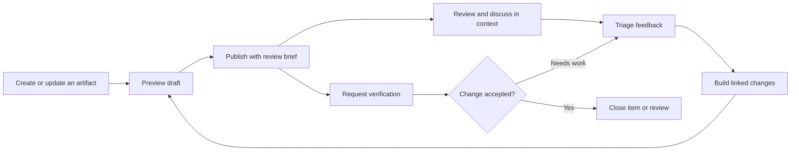

# Protolab: making the complete review cycle fluent

Research conducted: 23–24 November 2026  
Status: Research and proposed roadmap; application implementation is outside this report

## Recommendation

Build the next iteration around a complete review cycle: **prepare → review → decide → update → verify**.

Protolab already has useful foundations: self-contained HTML and Markdown uploads, a stable sharing URL, versioned annotations, threaded prototype comments, GitHub-backed document review, and an integration with coding agents. The recent work also makes hidden-target threads accessible and adds optional screenshot capture.

The largest opportunity is connecting those capabilities. Authors need to know what needs attention and whether changes satisfied the feedback. Reviewers need to understand the request, reach the right context, keep their work, and learn what happened afterward. These handoffs should become the organising structure of the product.

Prioritisation assumes recurring reviews between an author and a small team, including prototypes built with AI. External-client review would make invitation and access improvements even more urgent. This assumption needs validation with actual users.

## Research method and limits

This review combines:

- Inspection of the current application routes, templates, browser SDKs, annotation and version services, machine-facing API, and local integration handlers.
- Chromium walkthroughs using the actual templates and SDK with synthetic prototypes and intercepted API fixtures. Desktop viewport: 1440 × 1000. Small-screen viewport: 390 × 844.
- Isolated execution of the actual sharing routes and integration handlers, with mocked database, storage, and sessions.
- Fourteen official documentation, feature, and guidance pages covering Vercel, Marker.io, BugHerd, Pastel, Filestage, Nielsen Norman Group, MDN, and W3C. Sources are listed at the end.

The browser checks establish behaviour of the tested frontend with fixtures. The route checks establish behaviour of the tested handlers with controlled inputs. They are not production end-to-end tests. There were no customer interviews, production analytics, load tests, or authenticated trials of competitor products. Competitor features below are documented capabilities, not independently measured outcomes; vendor speed and ROI claims were not used.

The workspace changed during the review. Findings were reconciled with the latest inspected files and key source fingerprints were checked again on 24 November. In particular, the screenshot JSON upload limit has already been increased to 12 MB, so the earlier default-limit problem is **not an outstanding finding**. Existing application edits were left intact.

Evidence: [browser observations](research-assets/2026-11-23/results.json), [route and integration observations](research-assets/2026-11-23/code-observations.json), and [source fingerprints](research-assets/2026-11-23/source-fingerprints.json).

## 1. What the current journey asks people to do

| Stage | Current experience | Friction or missing handoff |
| --- | --- | --- |
| Create | Supply a name, an HTML/Markdown file, and an email allowlist. Initial upload creates a published v1. | No review brief or in-app check of the first upload before publishing. Repeated reviewers must be entered again. |
| Share | Copy a link; recipient enters an allowlisted email. | The entry page provides little context. Returning users go through the same gate; prototype access is stored as one session-wide prototype ID. |
| Review | Interact in View mode; switch to Comment to place a pin or text annotation. | Mode changes can discard a draft. Current-page filtering hides feedback elsewhere. The comments sidebar substantially changes the prototype's available width. |
| Triage | Author reads a table, opens a share link for context, and can delete comments. | Replying, determining status, inspecting the target, and managing the prototype are split across interfaces. |
| Update | Upload a draft through Versions or the coding integration, then publish it. | No draft-preview action in the Versions UI. No focused presentation of what changed or which comments were addressed. |
| Verify | Revisit the prototype and switch versions. | The reviewer UI does not surface the resolution fields already used by the machine API. There is no explicit return-to-review or verification step. |
| Reuse | Browse the prototype list or the separate Docs experience. | Limited organisation by project, activity, reviewer, or next action; Markdown uploads and GitHub docs use different review interfaces. |

## 2. Fix the interruptions first

These are concrete findings rather than speculative new features. **Reproduced** means exercised in the isolated checks; **code-confirmed** means the relevant implementation was traced.

| Priority | Finding and evidence | Consequence | Recommended correction |
| --- | --- | --- | --- |
| P0 | **Comment links lose context during entry — reproduced.** A link containing focus and version reaches a form posting to the bare entry route; its redirect is the bare view URL. Admin View links also omit the comment's version. | A reviewer or author cannot reliably arrive at the requested comment and version. | Provide one canonical comment link. Preserve a validated internal destination through access entry, including version and comment identity. Open the thread even when its target is unavailable. |
| P0 | **Platform URL parameters alter page identity — reproduced.** Comments recorded on the plain view URL disappear from the sidebar when the same version is opened with version and focus query parameters. | Fixing the entry redirect alone would still leave comment links unreliable. | Separate prototype route identity from Protolab's navigation parameters. Exclude reserved parameters from matching while preserving query/hash state that belongs to the prototype. |
| P0 | **Two prototype tabs interfere — reproduced.** Entering prototype B replaces the session's prototype ID; A's view and comment requests then return 403. | Reviewing a specification and prototype, or two alternatives, becomes fragile. | Store access grants for multiple prototypes or use a shared authenticated reviewer identity with per-prototype authorisation. Recheck each requested resource. |
| P0 | **The feedback tool omits comment IDs — reproduced.** Its output lists text, selector, and author but omits the ID required by its resolve tool. | The agent cannot reliably complete the advertised pull → fix → resolve sequence using the provided tools. | Return stable IDs in structured feedback and in the readable summary. Add explicit filters for open feedback and version. |
| P1 | **Mode switching loses unfinished feedback — reproduced.** Comment → View → Comment, then placing the pin again, produces an empty composer. | Users must rewrite feedback after checking another interaction. | Preserve drafts by prototype/version/target, restore them on return, and keep them through recoverable failures. Make discarding explicit. |
| P1 | **The small-screen shell consumes the prototype — reproduced.** At 390 px, the expanded sidebar is 260 px and leaves 130 px for the test prototype. Toolbar controls extend beyond the visible area. | Core reviewing controls and the prototype become difficult to use on small screens or at high zoom. | Use an overlay or bottom sheet on narrow screens, a compact toolbar, and an explicit toggle between content and discussion. |
| P1 | **Teammate feedback does not refresh on focus — reproduced and code-confirmed.** The prototype SDK fetches at boot and after local writes; focus/visibility events do not fetch comments. | A review session appears quiet or stale until the reviewer reloads or posts something. | Add a guarded focus refresh and polling first, or incremental event updates. Preserve composer text, selection, thread expansion, and scroll position. |
| P1 | **Explanation tags are discarded — reproduced.** The SDK offers the tag but the persistence allowlist excludes it, storing null. | A visible classification choice does not survive saving. | Use one tag definition across authoring, persistence, filters, and the integration. Clarify the relationship with the separate legacy Explanations feature. |
| P1 | **Historical admin preview can mix versions — code-confirmed.** The preview route loads the current published file, then selects comments independently using the requested version. | An old annotation can be shown against newer content. | Resolve content and comments from one version context and use that context throughout the renderer. |
| P1 | **Viewer roles see Publish — reproduced.** The upload form is hidden for viewers, but version action buttons remain visible. The mutation route requires admin. | The UI invites an action the user cannot complete. | Render actions from the same capability model used by the server. Keep version viewing available independently of publishing permission. |

Relevant code: [delivery routes](../src/routes/delivery.js), [review SDK](../public/sdk/feedback.js), [admin routes](../src/routes/admin.js), [admin detail UI](../src/views/admin-prototype-detail.html), [annotation service](../src/services/annotations.js), and [integration handlers](../mcp/lib/handlers.cjs).

The new hidden-target behaviour is a positive result: the test thread stayed readable while its field was collapsed, and its pin appeared when the section opened. Preserve that behaviour.

## 3. Recommended product improvements

### A. Make the prototype itself the review workspace

Give authors and reviewers one review surface, with controls appropriate to their role. Authors should be able to read a thread, inspect its context, reply, and change its status without moving through a table and another browser tab.

Use a persistent discussion panel with:

- All pages / This page scope.
- Open / Addressed / Closed status filters, search, and unread indicators.
- Previous/next thread navigation and shareable links.
- A readable target name or quoted passage; selector details can remain secondary.
- An author-only place to inspect captured screenshots, preserving the existing visibility policy.

The current API already returns all comments for the selected version before the SDK filters them by page. An All pages view is therefore a relatively contained first improvement. The larger step is sharing one thread component and action model across reviewer and author surfaces.

Keep management functions such as access logs, tokens, and deletion reachable through secondary navigation. The primary author action should lead to work needing attention. Retain a table as a secondary surface for bulk operations and future export.

Vercel documents an inbox, page/status filters, thread navigation, and copyable comment links [S2]. These are directly relevant interaction patterns.

### B. Give feedback an explicit lifecycle across versions

Introduce a small, understandable lifecycle:

**Open → Addressed in vN → Verified / Closed**, with Reopen available.

An author can link a change to a comment and mark it addressed. The reviewer, or a designated review owner, can then verify it. Questions can close with an answer; suggestions can close with a recorded decision. Do not force every observation to become implementation work.

Keep the distinction between three things:

- **Where feedback was made:** immutable original version and target context.
- **What happened to it:** discussion, decision, owner, and status.
- **Where it was addressed:** a linked later version or external work item.

Your existing version-scoped anchors should remain intact. An unresolved item can appear in the work queue after a new version is published while its original pin remains on the original version. This avoids silently moving old pins onto unrelated new elements.

The data model already has resolved_at and resolved_in_version, exposed through the machine-facing API. The reviewer annotation query does not return them, and the current review UI does not provide a matching lifecycle. Extend this foundation before adding a complex board.

BugHerd demonstrates triage, assignment, and completion visibility [S7–S8]; Vercel demonstrates resolution and participant notifications [S3]. Protolab can start with a list and a few statuses.

### C. Add a real preview-and-publish flow

An author should be able to inspect any draft before making it live. This deliberately revisits the earlier versioning design's decision to omit admin draft preview.

Proposed sequence:

1. Upload or receive a draft from the coding agent.
2. Open it in an authorised preview with the same review shell and an unmistakable draft label.
3. Review a short change note and linked feedback items.
4. Publish the explicitly selected version.
5. Offer a focused update to reviewers describing what needs another look.

Use the same sequence for the first upload, with an explicit quick path to publish when desired. Keep the stable shared URL and the ability to inspect older published versions.

Add comparison progressively. Markdown can use text differences; HTML can begin with side-by-side views at the same viewport and an author-written change note. Dynamic states require named scenarios or later state adapters before visual comparisons can be considered repeatable. A pixel difference between two uncontrolled interactive sessions is weak evidence.

Filestage documents old-version notices, comparisons alongside previous comments, and reviewer reminders [S11]. Vercel notifies viewers when their deployment is outdated [S1]. Protolab should show “A newer version is available” without forcing a reload that destroys the reviewer's current interaction or draft.

### D. Make sharing a review request

Replace the bare link handoff with a lightweight review brief:

- What this prototype explores.
- Two or three questions or tasks for the reviewer.
- Which areas are intentionally unfinished or out of scope.
- Optional due date and review owner.
- The version or review round being requested.

For example: “Try creating a campaign, then enable advanced delivery. Can you explain what the retry setting does? Please focus on the flow and labels.”

The author can reuse reviewer groups, add people through email chips, and see a useful distinction between invited, opened, and finished reviewing. Replace the technical term “Email Allowlist” in the main flow with “Who can review.” Preserve the underlying access boundary.

Returning authorised people should go directly to their destination. Authors already signed in should not need to identify themselves again as external reviewers. Access failures should offer a clear recovery path and retain the intended destination.

For guest access, choose a clear trust model: verified invitations/magic links or an explicitly enabled capability link. Typing an allowlisted email currently checks a string; it does not establish ownership of that email. That distinction becomes material if comments represent attributable decisions or invitations generate notifications. For an internal audience, reuse the organisation's authenticated identity where practical.

Pastel, Marker.io, and BugHerd all emphasise low-friction guest feedback [S4, S7, S9]. Their advertised convenience is a useful benchmark; their exact authentication arrangements should not be assumed to match Protolab's requirements.

### E. Make progress visible without making notifications noisy

Add an in-app activity inbox and thread subscriptions. Start with a narrow event set: a reply to your thread, a mention, a request to verify a change, or a new version relevant to your review.

Group events into a concise update such as: “v3 addresses your retry-setting comment. Review the change.” Link it directly to the correct version and thread. Let participants mute threads and choose a digest. Sending invitations or notifications is a future product feature; this research did not send messages to anyone.

Immediate frontend freshness and asynchronous notifications solve different problems. The first keeps two open review sessions consistent. The second brings someone back later. Build the reliable comment links and lifecycle before adding outbound notifications.

Vercel documents participant-based subscriptions, resolution notifications, digest-style batching, and notification preferences [S1, S3]. These provide a good starting point.

### F. Complete the coding-agent workflow

The existing integration is valuable, but the current handoff needs more precise context and fewer setup steps.

First repair the tool contract:

- Include IDs, original version, route, full text anchor, status, and replies in structured feedback. Provide a compact readable summary in addition.
- Allow explicit open-only and version filters. The current pull calculates an open count but still prints every comment, including resolved ones.
- Return the actual live version pointer. The current status handler selects the first historically published version, which can be wrong after an older version is made live again.
- Separate “latest remote version observed” from “source version this local file is based on.” Reading feedback currently advances lastPulled to the maximum published/draft number without downloading that source. A conflict token is not proof that the author has incorporated the newer draft.
- Link pushed drafts to the comments they address. An agent can propose that an item is addressed; publication and verification should remain distinct actions in the product.
- Offer authorised screenshot/context retrieval to owner/admin tooling only within the existing visibility policy. Do not expose images through public URLs simply to simplify the integration.

Then reduce setup: a “Connect your coding agent” flow could generate the manifest/configuration, check connectivity, and explain the local-file mapping. Add a create-from-file capability so the first prototype does not require manual creation followed by ID copying; the current machine API primarily operates on existing prototypes.

Competitor research changes the positioning here: Marker.io, BugHerd, and Pastel already advertise agent integrations [S5, S7, S9]. Protolab's stronger opportunity is a reliable link between feedback, source versions, changed prototypes, and human verification. Having an integration alone is not a distinctive product claim.

### G. Make HTML, uploaded Markdown, and GitHub docs feel related

Preserve their different content and storage needs while sharing interaction conventions: opening a thread, composing, replying, locating context, filtering, copying a link, saving a draft, and showing status.

The current GitHub Docs client already refreshes comments on focus and on an interval while protecting active composition. That is a useful pattern to apply to prototype review. Conversely, its visible comment cards provide deletion and a GitHub link but lack the prototype client's threaded reply experience, despite reply metadata in the underlying format.

Keep GitHub provenance and external links visible. A shared UI does not require migrating GitHub comments into the prototype database. A small adapter contract can expose capabilities and keep unsupported actions honest. Account for GitHub's author identity and permissions when presenting a Protolab participant; the present service uses a configured GitHub token.

Add a lightweight project container when teams need to review a spec and its prototype together. A project can group related artifacts and show which review is active. Avoid forcing every uploaded file into a complicated hierarchy.

### H. Preserve concentration, layout, and recoverability

For HTML, keep interaction and annotation modes explicit, but make switching cheap: retain the draft, support a discoverable keyboard shortcut, and allow the user to inspect another state before returning to the comment. Uploaded Markdown can offer a selection-triggered Add comment control, consistent with the Docs client.

Use keyboard-operable thread controls, visible focus, labelled icon buttons, and reliable focus return after closing a composer. Treat draft recovery and small-screen layouts as core review functionality.

The injected SDK currently overwrites body padding to accommodate its toolbar and sidebar. That can change the layout being reviewed. In the near term, preserve the host page's original styling and provide a content-preserving overlay mode. Longer term, evaluate a dedicated review shell and isolated prototype frame with a narrow messaging bridge; that requires careful handling of routing, authentication, and state, so it should not block the immediate usability fixes.

For the screenshot feature, preserve the already chosen opt-in capture and owner/admin-only visibility. Validate the remaining implementation details: capture currently happens when submitting an element comment, while the plan specifies pin placement; hiding controls synchronously before reading a video frame does not establish that the stream has delivered a fresh, control-free frame. These are code-level concerns requiring a real screen-capture check, not demonstrated capture failures in this audit. Keep capture failure independent of the comment's success.

MDN documents that each new screen-capture request needs a user gesture and permission; maintaining one granted stream can support multiple captures during that session [S13]. W3C's reflow guidance is relevant to the review controls at narrow widths and high zoom, while allowing exceptions for intrinsically two-dimensional content [S14].

## 4. A proposed end-to-end experience

Example: the author uploads a revised delivery prototype, previews the expanded settings scenario, and publishes v3 with two addressed comments linked. A reviewer receives a focused verification request, opens the original discussion alongside v3, tries the change, and marks it verified. The original v2 pin and screenshot retain their historical meaning.

For exploratory reviews, “Finished reviewing” should be a lightweight completion signal. Formal approval should be an optional, clearly separate decision.

## 5. Delivery priorities

Effort is relative scope, not a delivery-time estimate: **S** is contained UI/API work, **M** spans multiple surfaces or shared data, and **L** introduces a new cross-cutting workflow. Validate estimates during implementation.

| Order | Work package | Expected benefit | Scope | Dependency / acceptance check |
| --- | --- | --- | --- | --- |
| 1 | Canonical comment links, route identity, and multiple prototype access grants | People reliably reach feedback and can review related artifacts together | M | Open an old-version comment through entry while a second prototype remains usable. |
| 2 | Draft preservation, narrow-screen shell, accurate role actions, and tag consistency | Fewer interrupted or lost reviews | M | Retain text through mode switches; complete a review at 390 px and with a keyboard. |
| 3 | Integration identifiers, status accuracy, and explicit source basis | Makes the existing agent handoff actionable and understandable | S–M | Pull an item, identify it, upload a draft from a known source, and link the change to that item. |
| 4 | Authorised draft preview and consistent version resolution | Authors can inspect changes before sharing them | M | View draft content with the correct annotation context without changing the live URL. |
| 5 | Unified thread workspace, All pages scope, and lifecycle | Authors can triage and close the review loop in context | M–L | Reply and move an item through Addressed → Verified without losing original-version context. |
| 6 | Guarded refresh, activity inbox, and targeted update messages | Participants see relevant progress and return to verify | M | New replies appear without destroying drafts; update links reach the correct thread. |
| 7 | Review briefs, reviewer groups, and project-level organisation | Repeated reviews take less preparation and produce more focused feedback | M | Start a second review using saved participants and a brief template. |
| 8 | Version comparison and deeper Docs/HTML parity | Speeds verification across artifacts and iterations | L | Review changes alongside earlier feedback; keep the storage systems' capabilities explicit. |

Ship these as useful increments. For example, All pages filtering, preserved drafts, and IDs in agent feedback can deliver value before the entire shared workspace exists.

## 6. What to defer

- **Generic automatic interaction replay.** It remains fragile for arbitrary HTML; the previous plans already defer it. Saved context and optional future state adapters are more bounded work.
- **A full project-management suite.** Begin with review statuses and optional ownership. Where teams already use an issue tracker, linking or syncing accepted work may be more useful than maintaining another board. Marker.io explicitly emphasises this integration approach [S4].
- **An in-browser prototype editor.** Local authoring plus the existing integration already offers a productive editing path. Preview and review continuity have clearer immediate gaps.
- **Broad session recording as the default.** It adds capture, permission, storage, and interpretation work. Establish whether screenshots and contextual discussion leave meaningful gaps first. Marker.io's replay is a documented option for comparison, not a requirement to copy [S6].
- **Autonomous publication or final closure by AI.** First make source basis, feedback IDs, preview, and verification reliable. Automation should operate on an explicit product lifecycle.
- **Additional funnel visualisations before review metrics.** Current navigation events cannot establish completion of a review or success in a dynamic interaction that does not change the URL.

## 7. Measure whether the workflow becomes better

Use completed review cycles as the primary outcome. An increased number of comments is ambiguous: it might mean better participation, greater confusion, or more defects.

| Measure | Suggested definition | Why it matters |
| --- | --- | --- |
| Time to first reviewable artifact | Start of creation/upload to a successful authorised preview | Checks whether setup and publishing are fluent. |
| Successful comment navigation | Share/comment-link attempts that reach the intended version and thread | Directly measures a reproduced interruption. |
| Review participation | Requested reviewers who explicitly finish reviewing | Separates opening a page from completing a task. |
| Time to first useful response | Review request to first relevant comment or explicit completion | Measures the handoff to reviewers. |
| Feedback turnaround | Comment creation to addressed version; then addressed to verified | Distinguishes implementation delay from verification delay. |
| Reopened items | Verified/closed items reopened, with reason | Helps detect premature closure or weak verification. |
| Draft recovery and posting failure | Recoverable errors, lost-draft reports, retries, and successful recovery | Measures reliability of the central activity. |
| Review-cycle duration | Review opened to the review owner's completion decision | Measures the entire process without equating page views with progress. |

Start with explicit events and a baseline, then set targets. Do not infer task completion from scrolling, dwell time, or pin count. The existing funnel implementation groups navigation by email and return to a first page; it lacks an explicit review-session identity and task-completion signal. Same-page interactive flows are particularly poorly represented by that data.

### Validate with users before expanding scope

Run a small qualitative study with approximately 4–6 authors and 4–6 reviewers, including people unfamiliar with Protolab. This is for discovering friction, not estimating population-level success rates.

Give participants concrete tasks:

1. Prepare a prototype and invite two reviewers with a clear question.
2. Open two related artifacts and switch between them.
3. Comment on a field revealed by an interaction, then briefly inspect another state before posting.
4. Follow a link to a comment on an older version.
5. Triage feedback, preview an update, and publish it.
6. Return as the reviewer and determine whether the requested change was made.

Observe assistance needed, navigation errors, draft loss, time spent reconstructing context, and uncertainty about next steps. Ask what people did outside Protolab: copied text into chat, held a meeting, created a ticket, or manually checked who had responded. Those workarounds will help choose between notifications, reviewer groups, comparison, and integration work.

## 8. Evidence and screenshots

The screenshots use fabricated prototype content, names, and email addresses. They show the application's actual templates and SDK, not proposed designs.

- [Current author comment table](research-assets/2026-11-23/02-comments-desktop.png): context is separated from the prototype; row actions are mainly View and Delete.
- [Current Versions screen](research-assets/2026-11-23/03-versions-desktop.png): draft rows offer Publish without an in-app preview action.
- [Current review shell at 390 px](research-assets/2026-11-23/05-review-mobile.png): the expanded sidebar leaves a 130 px content area and the toolbar overflows.
- [Browser observation log](research-assets/2026-11-23/results.json): includes successful hidden-target recovery and the same-version query-parameter failure.
- [Route/integration observation log](research-assets/2026-11-23/code-observations.json): includes the access-session conflict, stripped destination, discarded tag, missing IDs, and the now-corrected upload-limit check.

Additional implementation references: [version service](../src/services/versions.js), [machine API](../src/routes/apiV1.js), [integration manifest handling](../mcp/lib/manifest.cjs), [Docs client](../public/sdk/docs.js), and [GitHub comment adapter](../src/services/ghComments.js).

Related existing plans: [interactive HTML comment context](html-prototype-comment-context.md) and [screenshot context decisions](comment-screenshot-context.md). The latter records the chosen opt-in capture approach and tighter image visibility; those choices are preserved here.

## 9. External sources

Accessed 23 November 2026. Product pages support the stated feature comparisons, not predictions of Protolab's business results.

| ID | Source | Evidence used |
| --- | --- | --- |
| S1 | [Vercel — Comments overview](https://vercel.com/docs/comments) | Contextual feedback, participant notifications, and notices of newer deployments. |
| S2 | [Vercel — Using comments](https://vercel.com/docs/comments/using-comments) | Inbox, page/status filters, thread navigation, mentions, and comment links. Screenshot capture options also document an extension requirement. |
| S3 | [Vercel — Managing comments](https://vercel.com/docs/comments/managing-comments) | Resolution, notification subscriptions/preferences, batched emails, and session context. |
| S4 | [Marker.io — Product overview](https://marker.io/) | Guest feedback, technical context, and synchronisation with existing work-management tools. |
| S5 | [Marker.io — MCP](https://marker.io/marker-mcp) | Agent access to report context, screenshots, and investigation workflows. |
| S6 | [Marker.io — Session replay](https://marker.io/features/session-replay) | Recorded pre-issue context, restricted replay access, and task-tool links. |
| S7 | [BugHerd — Product overview](https://bugherd.com/) | Guest feedback, screenshots, tasks, client collaboration, and advertised agent integration. |
| S8 | [BugHerd — Integrated Kanban board](https://bugherd.com/feature/integrated-kanban-board) | Triage, deduplication, ownership, work status, and completion notifications. |
| S9 | [Pastel — Product overview](https://usepastel.com/) | Link-based review, guest participation, live updates, feedback deadlines, resolution, and advertised agent integration. |
| S10 | [Filestage — Product overview](https://filestage.io/) | Review stages, version organisation, and recorded review decisions. |
| S11 | [Filestage — Document version control](https://filestage.io/document-version-control-software/) | Previous-version access, stale-version notices, comparisons with prior comments, and reminders. |
| S12 | [Nielsen Norman Group — Ten usability heuristics](https://www.nngroup.com/articles/ten-usability-heuristics/) | Status visibility, consistency, recovery, recognition, and focus on the user's task. Used as evaluation guidance. |
| S13 | [MDN — getDisplayMedia](https://developer.mozilla.org/en-US/docs/Web/API/MediaDevices/getDisplayMedia) | Browser support limits, user activation, surface selection, and non-persistent capture permission. |
| S14 | [W3C — Understanding reflow](https://www.w3.org/WAI/WCAG22/Understanding/reflow.html) | Usable controls and content at narrow widths and high zoom, including two-dimensional-content exceptions. |
